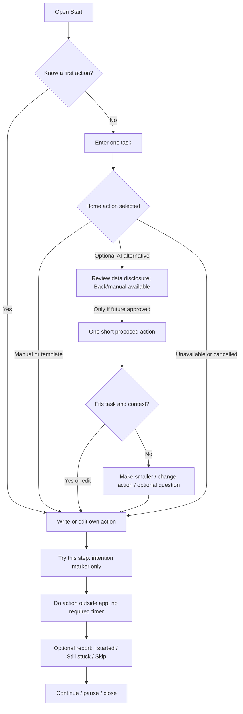
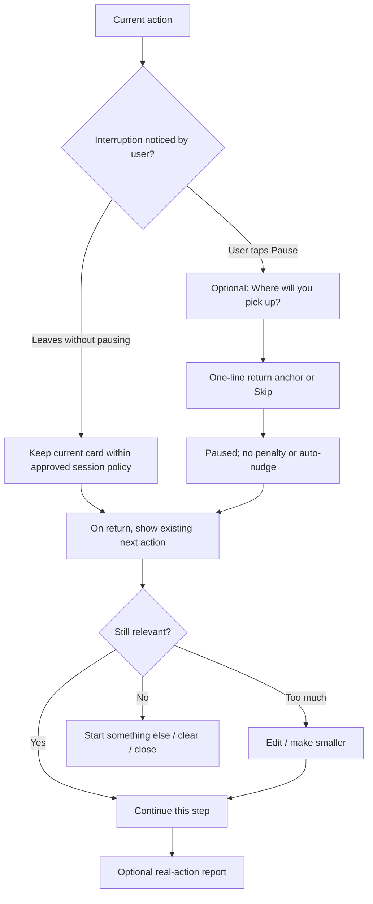

# ADHD UX research and initial prototype

Research date: 2026-10-22 (America/Toronto) | Owner: UX Researcher Subagent | Status: public-source desk research and untested static design proposal

## Mandate, method and limits

Target: adults with ADHD, English-market first, with future English/Chinese support. Founder authorized three independent Subagents, public research and local documentation on 2026-10-22. This agent owns only this file. No participants were recruited or observed by JustStart; no sensitive data was collected; no application was built. Neither this prototype nor its microcopy has clinical or usability approval.

Focused, non-systematic search of primary adult-ADHD usability/HCI studies, NIMH information and W3C guidance. Favor direct source pages; review publication dates, populations, design and limitations. This is not a systematic review, prevalence study, accessibility audit or evidence of demand. English-language and search-selection bias remain. Evidence labels: **E** = source-backed finding limited to its source; **G** = broad accessibility guidance; **H** = design hypothesis requiring testing. The designs below are H unless explicitly stated otherwise. Sources accessed 2026-10-22; historical product observations should not be read as a current competitor audit.

## Evidence that changes design decisions

| ID / type | Verifiable source and publication date | Finding within source limits | Product implication and uncertainty |
| --- | --- | --- | --- |
| UX-E1 / E, direct but small adult sample | Kenter et al., [MyADHD usability study](https://formative.jmir.org/2022/10/e37137), 2022-10-21 | Five Norwegian adults, self-reported ADHD diagnoses, staged laptop usability sessions. Problems included lengthy text, inconsistent terminology, unclear navigation and unclear saved state. A confusing calendar was removed. | Test clear labels, explicit persistence feedback, short text and one-action paths. Do not infer universal ADHD preferences, treatment effects, mobile success or benefit of JustStart. |
| UX-E2 / E, open feasibility | Knouse et al., [Inflow usability and feasibility](https://pmc.ncbi.nlm.nih.gov/articles/PMC9931323/), 2022-08-15 | Seven-week open study: 240 baseline participants, 95 usability assessments at week 7; online/waitlist recruitment, diagnosis not required. Positive usability does not establish causal benefit. Authors disclose company relationships. | Attractive presentation and early use cannot establish lasting real-world action; account for missing outcomes and selection effects. |
| UX-E3 / E, exploratory HCI | Chen et al., [Not Just Me and My To-Do List](https://arxiv.org/abs/2603.17258v2), submitted 2026-03-18, revised 2026-04-20; author reports CSCW 2026 acceptance | Interviews with 22 ADHD-identifying adults and a separate 20-person speculative-design study examine emotional/social scaffolding and AI support concepts. | Include social/environmental context in future discovery. Preference for a speculative concept is not evidence AI companionship works. This review checked the abstract and metadata, not every full-text result. |
| UX-E4 / E, exploratory preprint | Liu et al., [Community-Based Understandings of Time Management Challenges](https://arxiv.org/abs/2610.12629v1), 2026-10-08 | Human-led, LLM-assisted analysis of 5,379 relevant community posts reports support tools demanding self-regulation and emotional costs of breakdown. | Evaluate recovery burden and shame as well as task outcomes. Community identity, diagnosis, representativeness and coding validity limit generalization. Abstract/metadata checked; no individual posts collected here. |
| UX-E5 / E, official overview | NIMH, [ADHD in Adults: 4 Things to Know](https://www.nimh.nih.gov/health/publications/adhd-what-you-need-to-know), publication date not shown in consulted extract | Describes difficulties with organization, distraction, procrastination, remembering and large projects in adults. | A task list can retain intention while leaving several execution demands unresolved. That explanation is a design inference; not every adult has the same barrier. |
| UX-G1 / G | W3C, [Help Users Focus](https://www.w3.org/WAI/WCAG2/supplemental/objectives/o5-user-focus/), first published 2021-04-29 | COGA supplemental guidance addresses distraction and orientation. | Provide a stable current-action anchor and avoid intrusive content. Guidance covers cognitive disabilities broadly; it is not ADHD efficacy research or a normative WCAG requirement. |
| UX-G2 / G | W3C, [Make Short Critical Paths](https://www.w3.org/WAI/WCAG2/supplemental/patterns/o5p02-short-paths/), first published 2021-04-29 | Recommends keeping required paths short and optional steps separate. | No required goal-setting, mood survey or reward selection before an attempt. The exact screen count below is our hypothesis. |
| UX-G3 / G | W3C, [WCAG 2.2](https://www.w3.org/TR/2024/REC-WCAG22-20241212/), dated Recommendation 2024-12-12; [Timing Adjustable explanation](https://www.w3.org/WAI/WCAG22/Understanding/timing-adjustable.html), living explanation, accessed 2026-10-22 | Standard supplies testable accessibility requirements. | Proposed future AA target, keyboard operation, visible focus, contrast, reflow, status announcements and appropriately sized controls. Countdown never gates completion. Conformance requires future testing. |

### Why a to-do list may be insufficient

A stored item such as “write the report” does not specify a first observable action, necessary material, a stopping point or how to return after interruption. Remembering an intention and executing it are different demands. UX-E1/E3/E4/E5 motivate this interpretation; they do not prove a new application is needed. Existing lists, templates or a trusted person may already provide enough support.

Design around an **intentional attempt**, not accumulating tasks: “Help me start this one thing.” The proposed value is less thinking before useful action. A two-minute setup ritual can defeat that value. The current [PM competitor matrix](adult-adhd-needs-and-competition.md#current-competitors-and-meaningful-substitutes) identifies direct overlap: Taskmaster already offers sequential execution, timers and stuck-task breakdown; Tiimo advertises AI planning support. Low friction is a comparative hypothesis, not an established market gap. The specific hypothesis is that a small, editable action plus an optional return anchor can help some users without duplicating their planner. Avoid claiming a dopamine deficiency explains every moment of avoidance.

## Proposed core journey

Illustrative persona: an adult already uses a calendar and task list, wants to begin a low-risk writing task, and is stuck. This is a fictional scenario, not an interview-derived persona.

| Moment | User job / possible friction | Proposed experience | What future research must observe |
| --- | --- | --- | --- |
| Stuck | Knows intention; cannot translate it into action | Open directly to one task input; no account, diagnosis or mood questionnaire in prototype | Can the person identify what to enter without facilitator rescue? |
| Name it | Does not want to rewrite a project | Enter “Draft a meeting agenda”; example or manual next-step path available | Typing burden; tasks that should not be sent to AI |
| Find a start | Suggestions may be wrong or too trivial | One proposed action, visibly editable: “Open a blank note and type one agenda topic.” | Is it feasible, safe, meaningful and adequately contextualized? |
| Act | App itself may become distraction | “Try this step” opens quiet action card; user may leave app immediately | Real action begins; pressing the button is not a start outcome |
| Interrupted | Rebuilding context costs effort | Same current action reappears; “Continue this step” / “Make it smaller” / “Stop for now” | Can user resume without restating everything? |
| Close | Progress can be partial or absent | Optional “I started” / “Still stuck” / “Skip”; neutral acknowledgment | Useful action, burden, negative cases; missing report stays unknown |
| Return later | Does not want a backlog of failure | If explicitly retained, one last attempt offered, with age and “Start something else” | Return cue helpful versus stale, exposing or guilt-inducing |

## Information architecture

Candidate A has one main destination, **Start**. Quiet action and reflection are states of the current attempt, not additional feature tabs. Help and settings remain consistently reachable.

```text
Start
├── New task / manual next action
├── Current attempt (at most one; optional retention)
│   ├── Editable first action
│   ├── Quiet action card
│   ├── Pause / return anchor
│   └── Optional outcome
└── Help & settings
    ├── How suggestions work / limitations
    ├── Privacy / clear current attempt
    └── Accessibility / language preference

Long-term destinations (not in A navigation):
Focus companion + rewards [B]
Psychological skill support [B/C; evidence/professional gates]
Planning / learning & work / routines / life management [C]
```

Do not add a calendar, task inbox, community, activity feed or strategy library to A merely to fill navigation. Selecting among many tasks is a separate job; initially let the user bring one task. Persistence policy is a Founder/privacy decision, not implemented by this document.

## Home low-fidelity wireframes

ASCII is a static reading aid; it does not establish visual accessibility or usability. Square brackets indicate controls. Detailed disclosure text belongs in a readable inline panel, not tiny legal text.

```text
FIRST VISIT / NO CURRENT ATTEMPT
+------------------------------------------------+
| JustStart                       [Help / settings]|
|                                                |
| What would you like to start?                   |
| +--------------------------------------------+ |
| | e.g. Draft a meeting agenda                 | |
| +--------------------------------------------+ |
| [ Use a first-step template ]                  |
| [ I already know my first step ]               |
| [ Ask AI instead - optional ]                   |
|                                                |
| You can change any proposed step.              |
| Keep names and private details out of task text.|
| [How AI would use this text]                   |
+------------------------------------------------+

RETURN WITH EXPLICITLY RETAINED ATTEMPT
+------------------------------------------------+
| JustStart                       [Help / settings]|
|                                                |
| Continue your last attempt?                    |
| Draft a meeting agenda                         |
| Last updated: today, 10:15 AM                   |
| Next step: Type one agenda topic.              |
| [ Continue this step ]                         |
| [ Make it smaller ]     [ Start something else ]|
| [Clear this attempt]                           |
+------------------------------------------------+
```

The default prototype path is task input → a first-step template → edit the action → try. “I already know” bypasses the template; “Ask AI instead” is an explicit alternative, not a second mandatory mode-selection screen. AI-specific disclosure appears when that alternative is chosen, with Back/manual available. The first-visit privacy hint remains visible, but AI disclosure does not imply manual input is transmitted. Compare these paths as separate variants and count all clicks, input, disclosure reading and editing in setup-to-action time.

The AI information panel must explain the actual approved provider, destination, retention and training terms before any future submission. Do not display reassuring privacy promises before architecture and terms are known. A research mockup should state that no text is being transmitted. Manual mode must not quietly transmit task text.

## Task Initiation flow



Example controls and behavior:

- **Input:** “Draft a meeting agenda.” One short phrase suffices; no required deadline, category, energy rating or full project description.
- **Suggested step:** “Open a blank note and type one agenda topic.” Source label: “AI suggestion — edit anything.” Avoid sending, purchasing, deleting or committing on the user's behalf.
- **Context uncertain:** “Which are you starting: a new agenda or an existing draft?” This is optional, with “Skip — I'll write my own step.” One question at a time; no forced chat interview. If context is absent, do not invent tools, files or obligations.
- **Repair:** “Make it smaller” yields an alternative once, with edit control still visible. Repeated generation is not progress. After a further rejection, offer manual entry or stop rather than an endless suggestion carousel.
- **User already knows:** “My next action is…” bypasses generation and disclosure related solely to AI use.
- **Action card:** “Your next step / Type one agenda topic.” Primary “I started”; secondary “Still stuck”; persistent “Pause” and “Close.” No continuous conversational feed. A timer, if later useful, is optional, adjustable and stoppable; no countdown by default.
- **Acknowledgment:** “You started. Continue, or stop here.” Do not say the parent task is complete. If user chooses “Still stuck”: “Want a smaller step, a different step, or a pause?” Do not infer laziness, anxiety or a diagnosis.
- **No report:** Leaving the app can be successful action. No automatic failure state or follow-up notification. Outcome stays unknown unless voluntarily reported.

## Distraction and re-entry flow

Same-session recovery is a candidate A safeguard; persistent cross-session recovery is conditional on validation and an approved retention design. Session recovery does not imply surveillance or tracking other apps.



Return card microcopy: “Your last step: type one agenda topic.” Optional anchor: “Next: add the budget question.” Controls: “Continue this step,” “Change the step,” “Stop for now.” No “You were distracted for 34 minutes,” “You broke your streak,” or inferred cause. If no context survived, say “Your previous attempt isn't available. Start again or write your own step.” Never reconstruct fictional history.

Writing a return anchor is optional because preparing to recover can itself create friction. Do not require users to reflect on why they were distracted. Do not promise cross-device restoration until it exists. On a shared device, retention of task titles can reveal personal information; clear affordance, explicit policy and privacy review are prerequisites.

## Key states and interaction specifications

| State | Visible message / controls | Proposed behavior and validation question |
| --- | --- | --- |
| Empty | “What would you like to start?” + input + manual option | No list of unfinished obligations. Can users start without onboarding? |
| Input invalid/empty | “Add a task, or write your own next step.” | Keep focus and typed content; avoid color-only error signaling. |
| Suggesting | “Finding one possible first step…” + Cancel + manual option | Announce status accessibly, do not seize focus. Duration/failure threshold must be defined later; no fabricated progress percentages. |
| Suggested | One action + Edit + Make smaller + Try this step | Editable, not authoritative. Preserve original wording when suggestion changes. |
| Missing context | One optional clarification + Skip/manual | Do not expose a questionnaire or invent specifics. |
| Poor fit | “That doesn't fit? Change it or try a different step.” | User need not defend rejection. No penalty. |
| AI unavailable / no network | “Suggestions aren't available. Write one small action to try.” | Keep input and allow manual attempt; no repeated automated retry loops. |
| Active | Current action + I started / Still stuck + Pause / Close | No auto-lock, sound or app-switch detection; leaving app is allowed. |
| Paused / returning | Last user-approved action; optional anchor; Continue / Change / Stop | Explicit saved/session-only indicator reflects actual behavior. Do not auto-resume timer or reminders. |
| Partial / started | “You started. What next?” + Continue / Stop here | Distinguish step progress from parent-task completion. Reflection optional. |
| Stopped | “Stopped for now.” + Start something else / Close | No guilt, lost XP or mandatory explanation. Clearing retained content remains available. |
| Clinical or dangerous request | Explain relevant boundary; exit or appropriate human support | Do not decompose medication changes, dangerous actions or clinical treatment requests. A low-risk alternative is appropriate only when the situation permits; no clinical advice. |
| Immediate danger or urgent distress | Suspend productivity and reward generation; reviewed human-help route | Do not offer a routine manual-task fallback as the urgent response. Professionally reviewed routing and maintained regional resources are release prerequisites; this document supplies no crisis scripts or numbers. |
| Content cleared / unavailable | Clear truthful state + New attempt | No promise of backup deletion or model-provider deletion without verified capability. |

## Manual, rules and AI comparison

| Approach | Useful role | Limit | Proposed decision test |
| --- | --- | --- | --- |
| Own action | User knows what to do and needs a gentle attempt boundary | Still requires generating an action | Must remain a complete path; compare burden against opening a note |
| Simple template/rules | “Open [tool/material] and do [one observable action]”; prewritten safe examples | Can feel generic; object and context still user-supplied | Baseline in future counterbalanced study; no live model necessary |
| Bounded AI | Convert messy task language into one contextual candidate; repair a step without rewriting the task | Latency, private text exposure, wrong assumptions, convincing unsafe output, regeneration distraction | Retain only if useful real-world starts improve beyond template without greater burden, risk or cost |
| Open-ended companion | Potential perceived company/support through an attempt | Conversation may replace action; dependency and surveillance expectations | B research only, separate from A; human body doubling evidence cannot validate AI equivalence |

A common task such as “wash one plate” may need no AI. AI is a candidate intervention on ambiguity, not an identity requirement. Do not hide the manual path or penalize it in measurement.

## Low-friction ideas worth testing

All are unvalidated product ideas, not evidence-backed ADHD treatments.

| Idea | Mechanism hypothesis | Cheapest future test | Phase / kill condition |
| --- | --- | --- | --- |
| One-action lens | Showing one next action reduces effort of interpreting a whole plan | Static card versus full decomposition versus own template | A candidate; drop if feels patronizing or hides necessary context |
| “Already know” bypass | Users need a starting cue, not generated advice every time | Manual path offered before AI | A candidate; keep if it saves effort even when AI adds no value |
| Return anchor | A user-approved continuation note lowers reconstruction burden | Static interrupted-task walkthrough | A conditional; drop required writing or persistent state if it adds burden |
| One-tap smaller alternative | Repair one dimension rather than regenerate a complete plan | Compare edit, smaller, and regeneration | A candidate repair; stop if it encourages trivial non-progress |
| Optional effort preference | “Keep it light” offers a smaller action or explicit “Rest / stop,” without mood disclosure | Compare wording and action feasibility with explicit optional choice | B/C research; never infer health state from behavior |
| User-owned strategy card | Save “What helped me start” as an explicit preference | Paper card across fictional scenarios, later separately approved longitudinal study | C; no hidden sensitive behavioral profile |
| Quiet AI company | A bounded companion present without constant conversation | Nonfunctional storyboard and human-vs-AI expectation check | B; reject emotional coercion or unsupported equivalence to human presence |
| Personal acknowledgment/reward | Optional chosen cue marks a useful action | Compare neutral acknowledgment, chosen cue and no cue | B; do not reward disclosure, prolong app time or punish absence |

## Accessibility, mobile and future localization

Propose WCAG 2.2 AA as a future acceptance target, subject to Founder approval and actual audit. Plan keyboard and screen-reader paths, meaningful button names, visible focus and correct heading order. Announce generation/error/save status without stealing focus. Check contrast, text resizing and narrow-screen reflow; do not rely on color, animation or icon-only meaning. Aim for comfortable 44-by-44 CSS-pixel touch targets as a design preference; the WCAG AA minimum has a 24-by-24 rule with exceptions and should not be misquoted as 44. Respect reduced motion, disable celebration by default and avoid flashing. No drag-only interaction, memory puzzles or mandatory timed input. Optional timers must permit stopping and adjustment, and no task access expires when time runs out.

Mobile: keep the primary action visible with the keyboard open; multiline input must expand; preserve content across accidental back navigation within the approved session policy. Test one-handed reach, landscape, zoom, switch access and actual assistive technology later. Do not assume a visually sparse design is automatically accessible or universally preferable; allow sufficient explanatory context and user choice.

English first: use stable terms (“task,” “step,” “attempt”), plain literal language, optional pronunciation-friendly labels and no diagnostic slang. Future Chinese: allow wrapping and font fallback, composition input, localized date/time and count formats, language-specific screen-reader labels, and professional/UX review of translated psychological copy. Chinese support is a roadmap capability, not a claim that translated English research transfers culturally. Avoid embedding interface strings into images or treating language as ethnicity.

## Core versus conditional scope recommendation

**Candidate A core for Founder review:** one task/own-step entry; one editable safe action; bounded repair; quiet attempt card; pause/stop/skip; truthful optional outcome; manual fallback; clear AI identity/data disclosure; accessibility and safety controls. No design is approved for implementation.

**Conditional A discovery item:** same-session re-entry to the current action is a low-complexity orientation safeguard. A persistent return anchor, saved preferences, timer and cross-session history need evidence of usefulness, retention approval and explicit scope selection. Do not bring B's active companionship into A through “resume.”

**Retain in B/C:** AI body doubling, optional immediate rewards and personalized gamification, CBT/ACT skills with professional review, explicit emotion/energy preferences, AI daily planning, learning/work support, long-term life management and user-owned behavioral strategies. Their continued roadmap presence is not approval to build or bundle them.

## Future validation proposal and falsifiers

No new study is authorized by this document. Static, AI-labelled examples can test comprehension, wording, editing and acceptability of selected content; they cannot estimate real generation quality, unsafe-output rates, latency, cost or incremental AI performance. Any live/model-generated comparison needs separate authorization, approved provider/data handling, a representative synthetic evaluation set and independently reviewed safety/usefulness results. A polished curated example must not stand in for actual model behavior. After Founder approves protocol, privacy/consent, resources and relevant professional review: use fictional or sanitized low-risk tasks, counterbalance own method/template/AI-labelled static examples, and capture facilitator assistance. Include people who prefer their existing tools or dislike AI; avoid only enthusiastic early adopters. Assess ability to find a first action, edit, decline, pause, re-enter and leave. Observe real action when possible and distinguish it from optional self-report.

Report end-to-end preparation time from opening/choosing the task to first action as well as the existing five-minute attempt metric. That prevents a short post-button metric hiding lengthy setup. Clicking “Try this step” records intent only; “I started” is self-report, not independently verified behavior. Record non-starts, skipped reports and unknown outcomes separately. A user leaving the app is neither proof of start nor proof of failure. Do not reward reporting or return visits. Return counts measure app behavior; useful action and burden determine product value.

Falsifiers: a normal note/template performs equally or better; existing apps already satisfy the job; deciding to use JustStart requires more effort than the task; suggestions are trivial or contextually wrong; users need resources, rest, accommodation or human help rather than smaller steps; recovery cards expose private context; neutral copy still feels judgmental; benefits vanish after novelty. A meaningful first action should advance the intended job or a necessary prerequisite, not merely create app activity.

## Handoff and review status

Prepared by an actual independent UX Researcher Subagent. Independent PM and Behavioral Science cross-review was completed and resolutions are recorded below; desk research and static design remain proposals after AI review. Coordinator integrates shared documents. Next action is Founder review, not recruitment or implementation.

### Independent cross-review performed by this agent

On 2026-10-22, the UX Subagent independently read the PM report, [Adult ADHD needs and competitive opportunity](adult-adhd-needs-and-competition.md). No blocking inconsistency found. Sent two medium recommendations to PM/coordinator: explicitly measure setup-to-action latency in addition to the post-attempt start window, and clarify that a retained “confirmed step” means user-approved text rather than inferred execution, with present-session versus persistent memory separated. Also recommended an explicit skip/no-report path and unknown outcomes for departure. These are recommendations, not evidence of participant performance. Direct Taskmaster comparison, manual bypass and resource/rest counterexamples strengthen the proposed comparison.

### Independent PM review received and resolved

On 2026-10-22 the PM Subagent independently reviewed this UX file. Medium finding 1: home actions and a later mode-selection node implied inconsistent critical paths. Resolved by specifying a complete default template/manual path, an explicit optional AI alternative with disclosure before transmission, and inclusion of every click/read/edit in setup time. Medium finding 2: selected static AI-labelled examples cannot validate operational AI advantage. Resolved by separating static comprehension checks from separately approved future live-model evaluation, reliability, latency and cost assessment. Low finding: overlap with current competitors needed a direct reference. Resolved with a link to the PM matrix and explicit Taskmaster/Tiimo overlap. These corrections do not establish efficacy or Founder design approval.

### Independent Behavioral Science review received and resolved

On 2026-10-22 the Behavioral Science Subagent reviewed this UX file and found no blocking safety issue. Medium recommendation: distinguish clinical/dangerous requests from immediate danger or urgent distress. Resolved with separate states; urgent risk suspends productivity/reward generation and requires a reviewed human-help route, not routine manual-task fallback. Low recommendation: low-energy variants must explicitly allow rest/stop. Added to the optional effort-preference concept. Small exploratory AI-companion evidence does not establish equivalence to a human, or effectiveness of this design.
